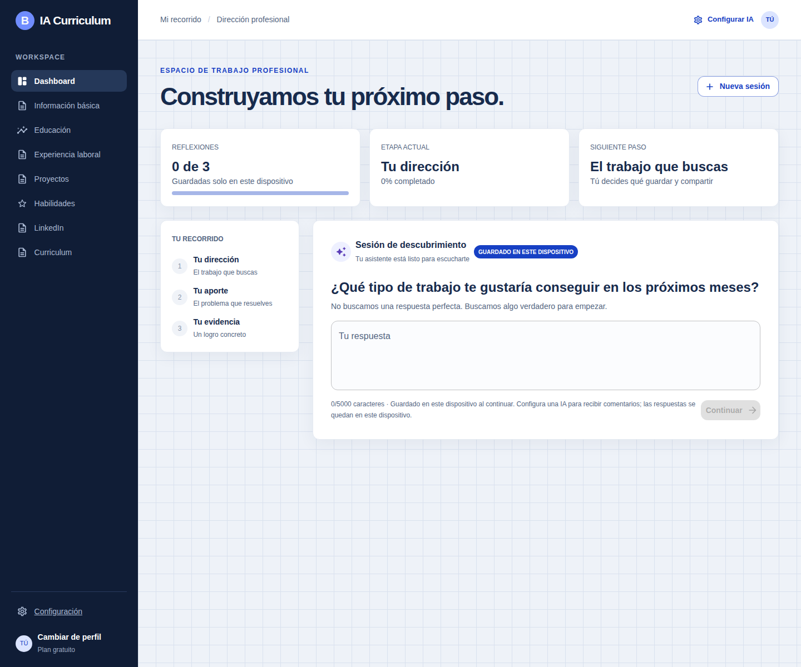
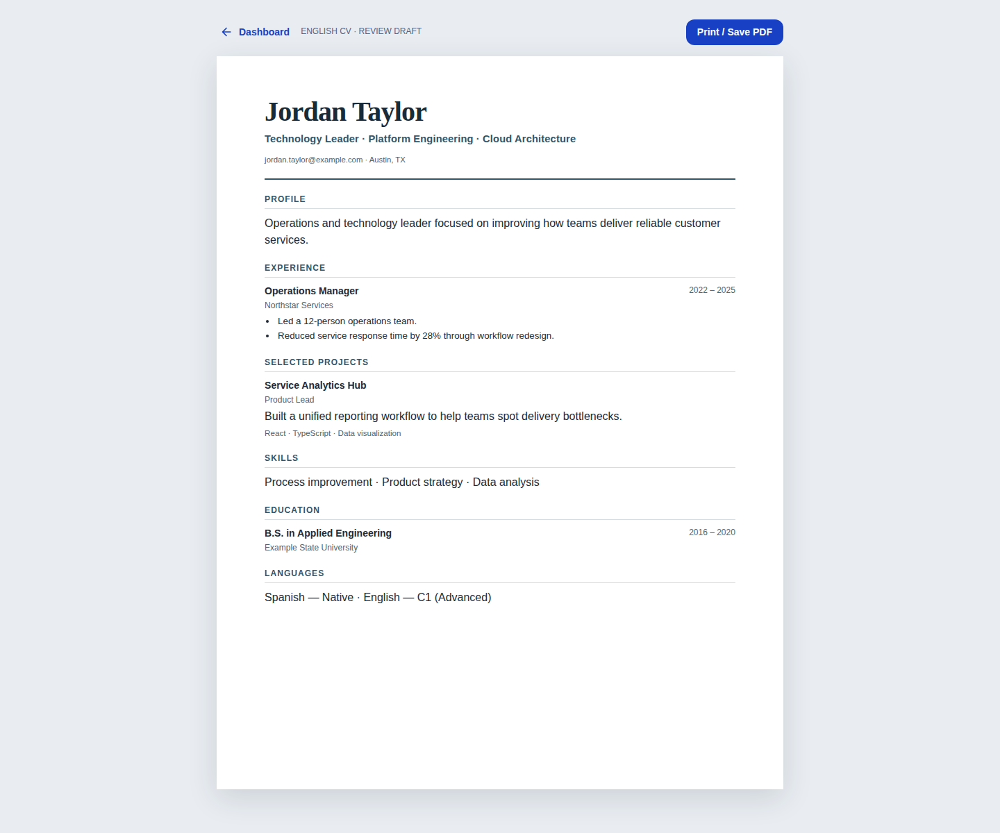
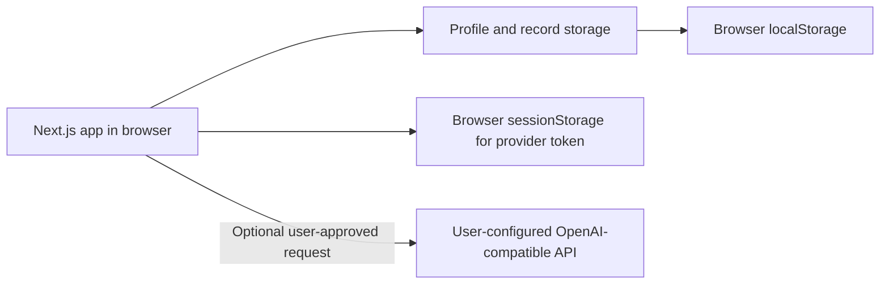

# IA Curriculum

A local-first workspace for turning career reflections into an organized professional profile. The interface is currently in Spanish. AI support is optional and connects directly from the browser to an OpenAI-compatible provider that you configure.

> **Project status:** personal project in active development. There is no hosted service, account system, or production support commitment.

## What it does

- Keep multiple career profiles separate in the current browser.
- Guide a short reflection flow and save answers on this device.
- Organize education, experience, projects, and skills as editable records.
- Review AI-assisted proposals before saving them as profile facts.
- View a LinkedIn-oriented summary and print a CV to PDF.
- Export a profile and its records as JSON, or delete its local data.
- Use the app without an AI provider; AI credentials are optional.

## Screenshots

These screenshots use a synthetic sample profile and contain no real user data.

**Workspace**



**English CV preview**



To browse the app without installing it, open the screenshots above or the [screenshots folder](docs/screenshots/).

## Quick start

Requirements: Node.js 22 (Node.js 20.9 or newer is supported) and npm.

```bash
npm ci
npm run dev
```

Open <http://localhost:3000>. The app creates example profiles in browser storage. No backend or database is required.

### Optional AI provider

Open **Settings** in a profile and enter an OpenAI-compatible API base URL, model, and token. The token is kept in that browser tab's `sessionStorage` and removed when the browser session ends. It is never stored in the repository or sent to an IA Curriculum server.

The browser sends the conversation and text you submit directly to the provider you choose. The provider may retain or process it under its own terms. Use an endpoint you trust, review its privacy policy, and avoid entering information you do not want to send. Remote endpoints must use HTTPS; local HTTP endpoints are allowed. The provider must permit browser requests from the app's origin (CORS).

`NEXT_PUBLIC_AI_PROVIDER`, `NEXT_PUBLIC_AI_ENDPOINT`, and `NEXT_PUBLIC_AI_MODEL` may supply non-secret defaults at build time. These values are visible to browser users. **Never put an API key or other secret in a `NEXT_PUBLIC_*` variable.**

See [AI integration](docs/ai-integration.md) and [privacy and security](docs/privacy-byot.md).

## Development checks

```bash
npm run lint
npm run typecheck
npm test
npm run build
```

End-to-end tests use Chromium and start the production build on port 3010:

```bash
npx playwright install chromium
npm run test:e2e
```

Run all local checks with `npm run check`. See [contributing](CONTRIBUTING.md) for the full workflow.

## Architecture



- `app/` contains the App Router pages and client workspace.
- `lib/workflow.ts` contains deterministic reflection flow logic.
- `lib/profiles/` manages browser-local profile and record data.
- `lib/ai/` handles provider configuration, streaming, and proposal parsing.
- `tests/` contains unit and browser end-to-end tests.
- `docs/` describes architecture, data handling, roadmap, and release checks.

More detail: [architecture](docs/architecture.md) · [documentation index](docs/README.md).

## Known limitations

- Data is tied to the browser and device. There is no sign-in, sync, backup, or server-side storage.
- The AI integration supports OpenAI-compatible chat-completions APIs. Native provider-specific APIs are not adapted.
- AI responses are temporary suggestions; the app does not persist them as confirmed profile facts.
- The reflection flow is a small starter workflow, not a complete career-coaching program.
- LinkedIn and CV views are working drafts. The CV print layout is currently English-only; locale-specific templates and server-side PDF generation are not implemented.

## Contributing

Issues and pull requests are welcome. Please read [CONTRIBUTING.md](CONTRIBUTING.md), follow the [Code of Conduct](CODE_OF_CONDUCT.md), and never include personal profile data, provider tokens, or real user conversations in a change.

## Security

For a suspected vulnerability, use GitHub's **Report a vulnerability** feature on this repository. Do not publish exploitable details in a public issue. See [SECURITY.md](SECURITY.md).

## License

MIT. See [LICENSE](LICENSE).
