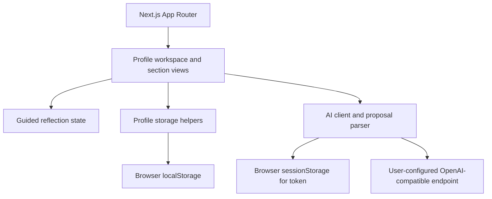

# Architecture

## Application layers

- `app/` contains the profile selector, profile workspace, editable sections, settings, and output views.
- `lib/workflow.ts` owns the small deterministic reflection flow and response limit.
- `lib/profiles/storage.ts` stores profile metadata and exports/deletes profile data.
- `lib/profiles/records.ts` provides per-profile CRUD for career records.
- `lib/ai/config.ts` separates persistent non-secret settings from tab-scoped tokens.
- `lib/ai/client.ts` makes bounded, cancellable chat-completions requests and parses streaming events.
- `lib/ai/extraction.ts` restricts model proposals to requested fields and requires user review before saving.

## Data flow

Profile metadata, answers, and career records remain in browser `localStorage`. Provider tokens are kept in `sessionStorage` for the current tab session. When configured, the browser sends reflection answers directly to the selected provider; the application server does not proxy or store those requests. Public `NEXT_PUBLIC_AI_*` settings are build-time defaults and must never contain secrets.

## Boundaries

- This is a local-first application, not an account system or hosted service.
- Browser storage is device- and browser-specific; it does not sync or back up data.
- Provider privacy, availability, compatibility, and CORS behavior are outside this repository's control.
- AI output is an untrusted proposal, not a verified career fact.
- The CV currently uses browser print/save-to-PDF and has one English print layout.
