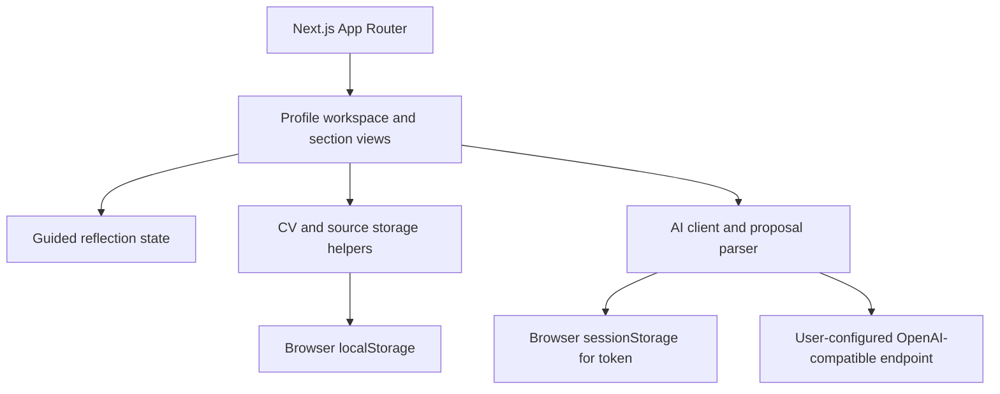

# Architecture

## Application layers

- `app/` contains the profile selector, profile workspace, editable sections, settings, and output views.
- `app/components/` holds reusable screens and focused UI panels; `section-page.tsx` coordinates section data and delegates settings controls.
- `app/i18n.tsx` provides the Spanish and English interface strings and stores the selected locale in browser storage.
- `lib/workflow.ts` owns the small deterministic reflection flow and response limit.
- `lib/profiles/storage.ts` stores profile metadata and exports/deletes profile data.
- `lib/profiles/cv-templates.json` and `cv-palettes.json` define independent layout and color catalogs; per-CV selections are stored with profile metadata.
- `lib/profiles/records.ts` stores basic records per CV and education, experience, projects, and skills in one shared source.
- `lib/profiles/field-labels.ts` translates stored field keys at the UI boundary while keeping unknown keys intact.
- `lib/ai/config.ts` separates persistent non-secret settings from tab-scoped tokens.
- `lib/ai/client.ts` makes bounded, cancellable chat-completions requests and parses streaming events.
- `lib/ai/extraction.ts` restricts model proposals to requested fields and requires user review before saving.
- Exported storage, workflow, and AI helpers document their side effects and fallback behavior with TSDoc comments.

## Data flow

CV metadata, answers, CV-specific basic information (including headline and summary), appearance preferences (template, palette, section icons), and the shared career source remain in browser `localStorage`. A new installation starts with empty profile and career stores; existing profiles are read without renaming or replacement. Legacy per-CV education, experience, project, and skill records are consolidated into the shared source on first read; originals are retained in local storage. Provider tokens are kept in `sessionStorage` for the current tab session. When configured, the browser sends reflection answers directly to the selected provider; the application server does not proxy or store those requests. Public `NEXT_PUBLIC_AI_*` settings are build-time defaults and must never contain secrets.

## Boundaries

- This is a local-first application, not an account system or hosted service.
- Browser storage is device- and browser-specific; it does not sync or back up data.
- Provider privacy, availability, compatibility, and CORS behavior are outside this repository's control.
- AI output is an untrusted proposal, not a verified career fact.
- The CV uses browser print/save-to-PDF with Spanish and English labels.
