# Screenshot gallery

These screens use fictional sample data generated in a temporary browser session. They do not contain real profile information or provider credentials.

All screenshots show the English interface for a consistent walkthrough.

## Choose a profile

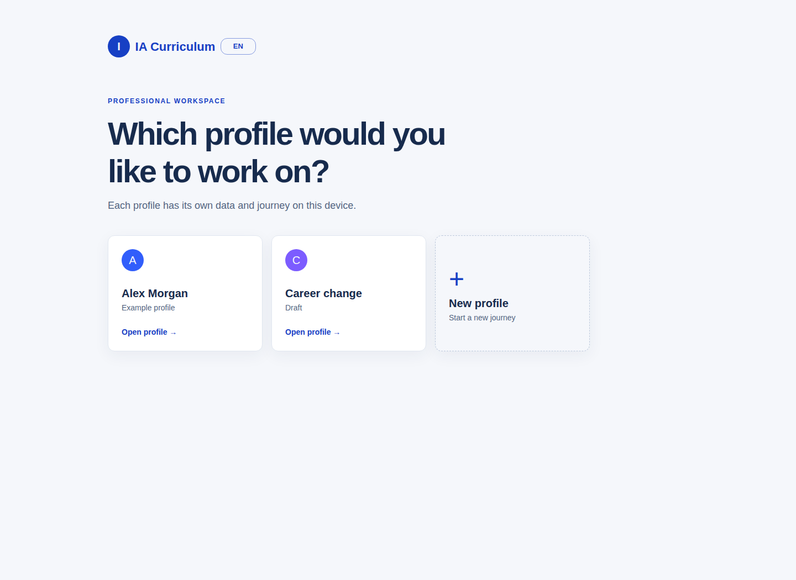

## Guided reflection

Start with the first prompt:

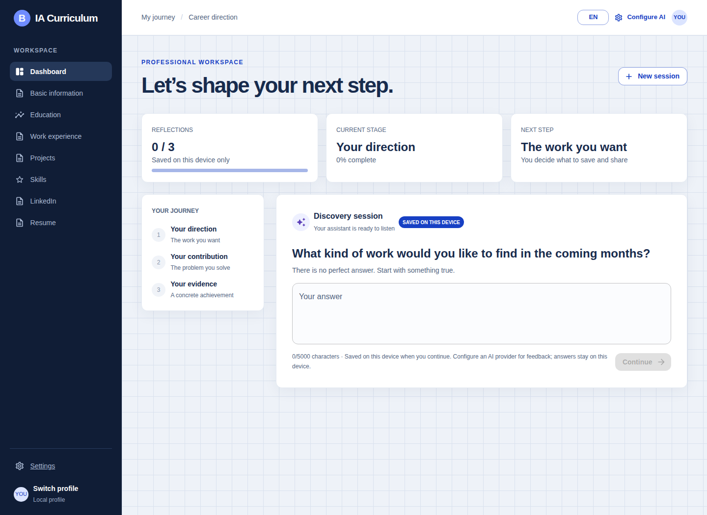

After one answer, progress and next step update together:

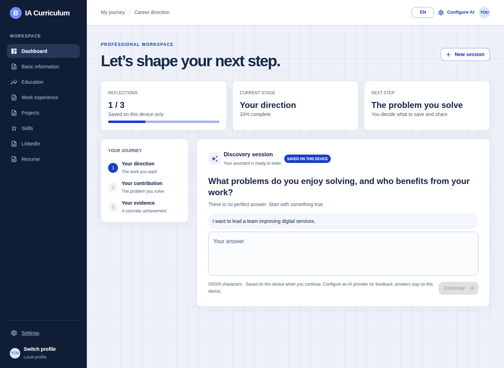

Review the saved answers when all three prompts are complete:

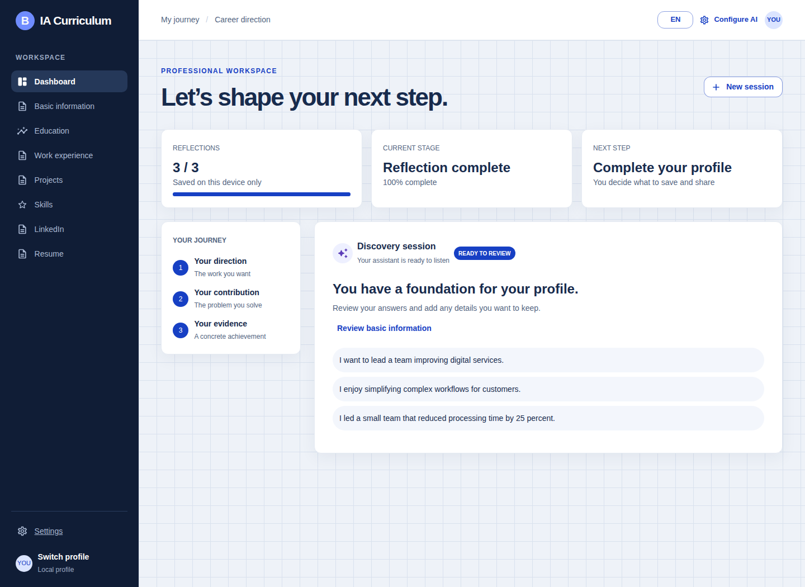

## Build a professional profile

Basic information:

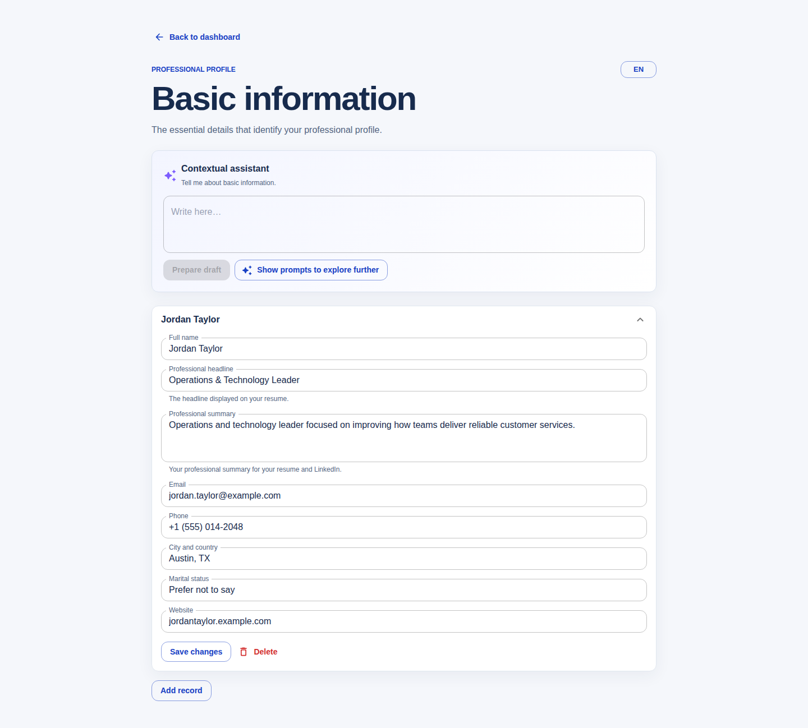

Experience, including multiline achievements:

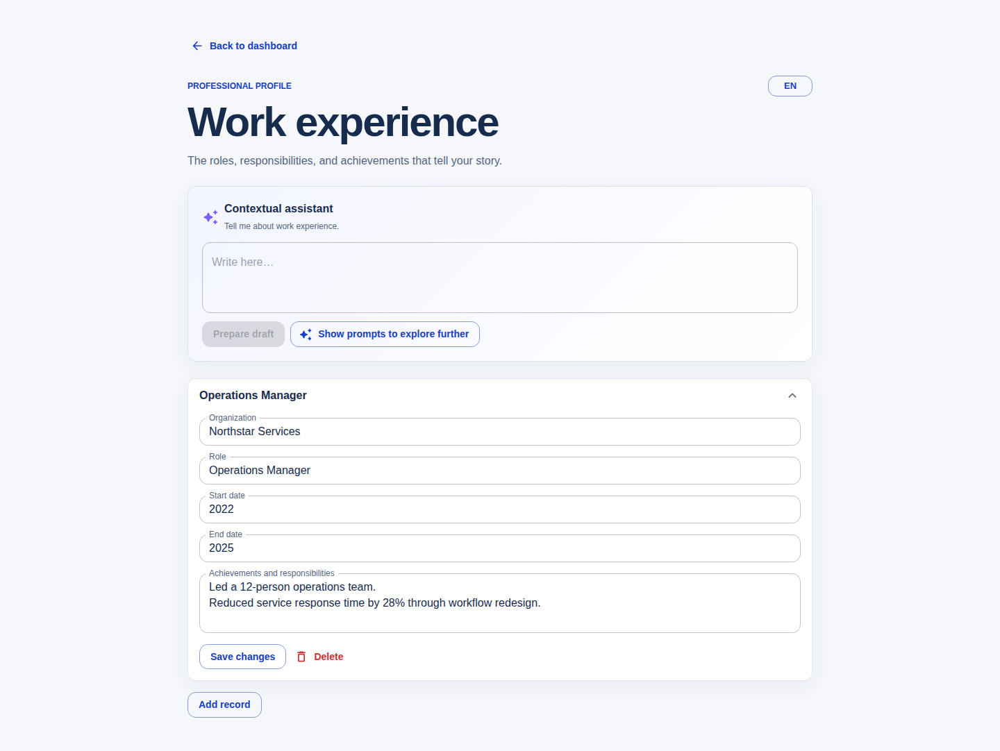

Education:

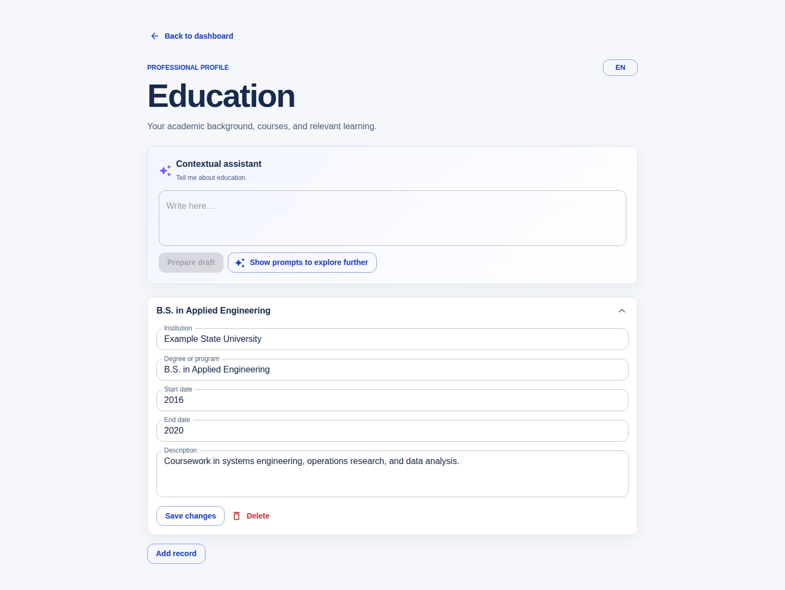

Projects:

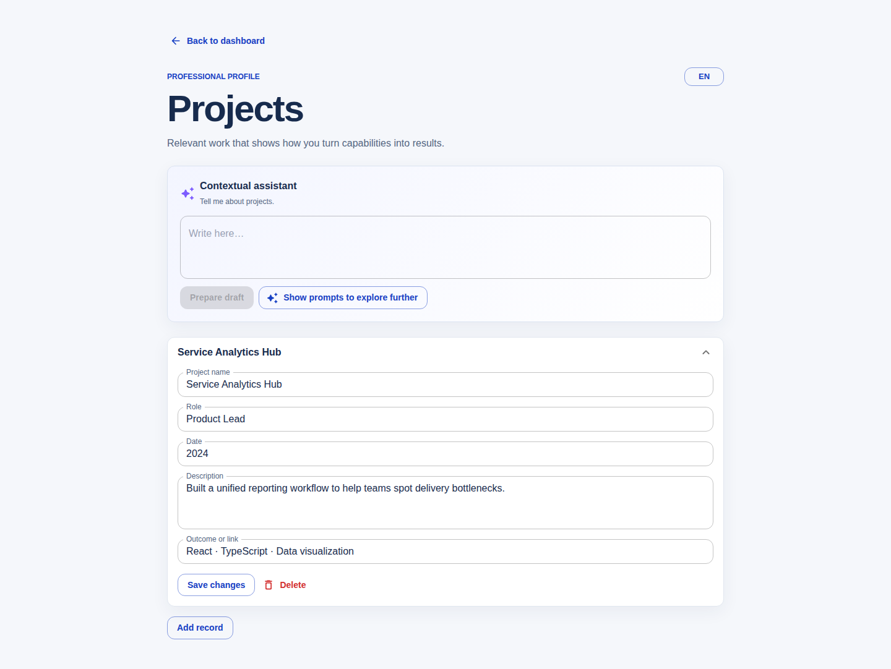

Skills:

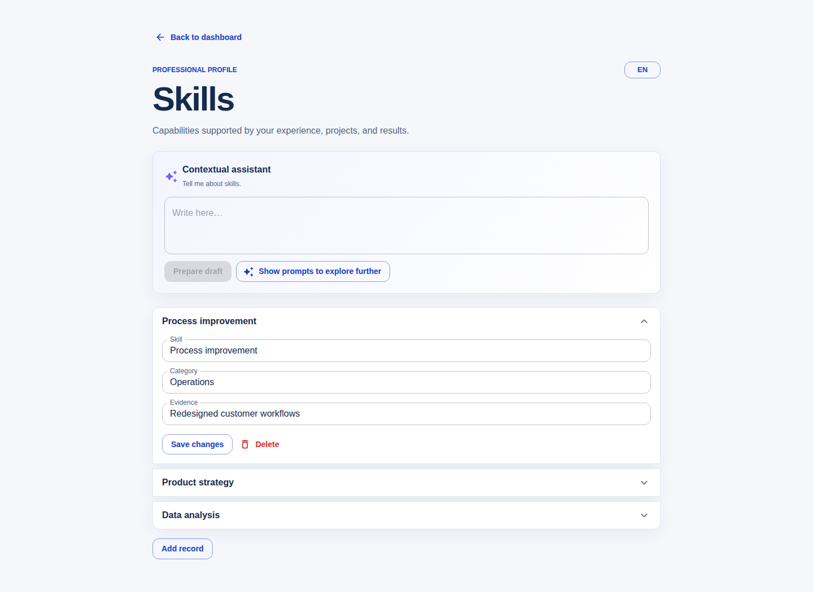

## Review and export

LinkedIn-oriented profile preview:

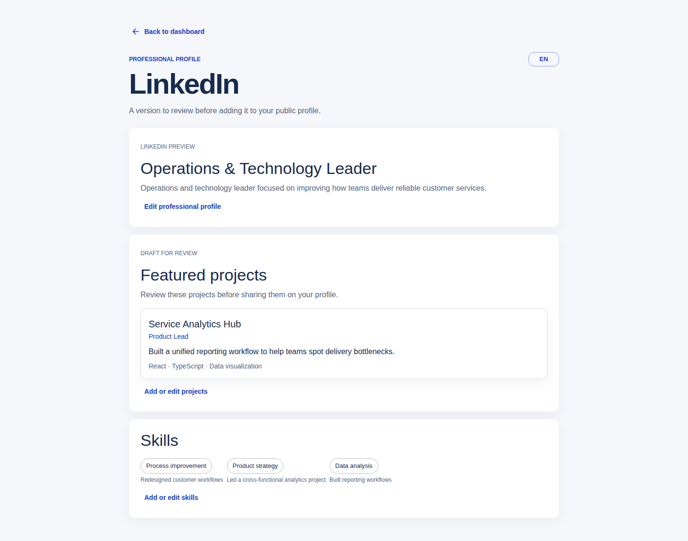

Optional provider and local-data settings:

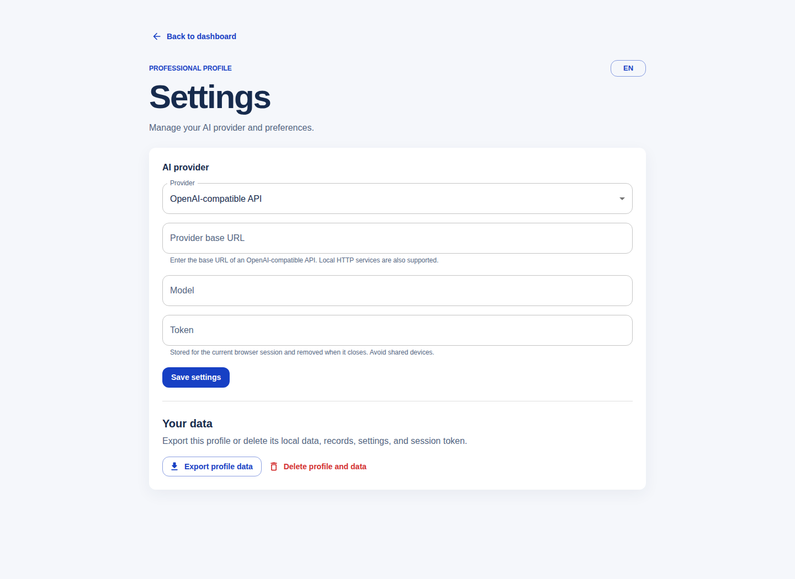

Printable English CV:

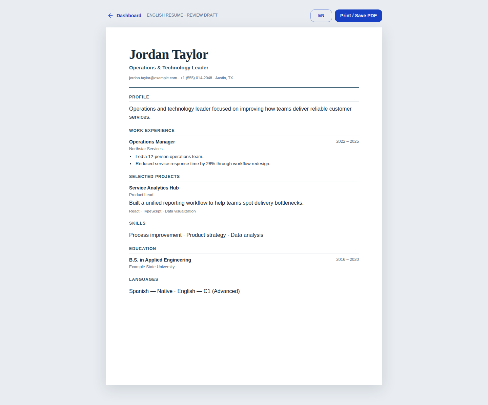

Mobile navigation:

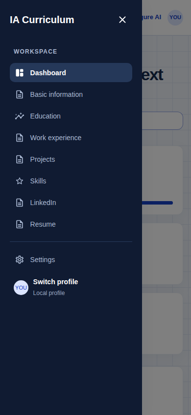
