# From a goal to a reviewed resume

This walkthrough follows one user journey in the current MUI 9 interface: create a CV, reflect on a goal, maintain career evidence, then review and export. All examples are fictional, captured in English on November 19, 2026, without provider credentials. Click an image to open it at full size.

## 1. Start with an empty workspace

A new installation contains no sample profiles. Choose **Create a resume** to begin.

[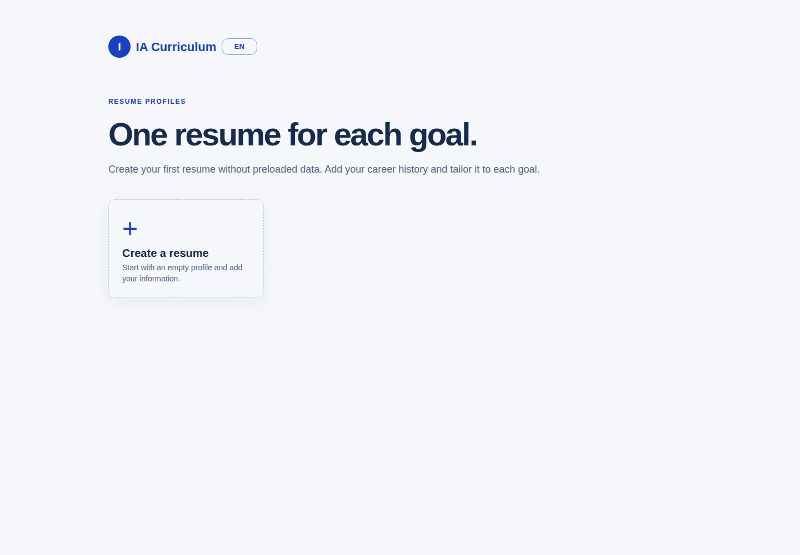](screenshots/journey-start.png)

## 2. Name the CV and define its goal

Enter a name, focus, and optional role description. This first CV starts without a source. For later CVs, the dialog can copy basic information from an existing CV while reusing shared career history.

[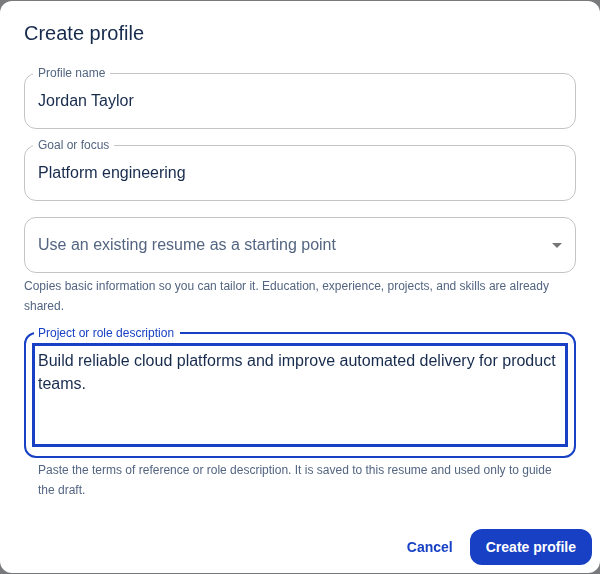](screenshots/journey-create.png)

## 3. Reflect before drafting

Answer the three questions about direction, contribution, and evidence. With no provider configured, answers stay in the browser. Progress updates after continuing.

[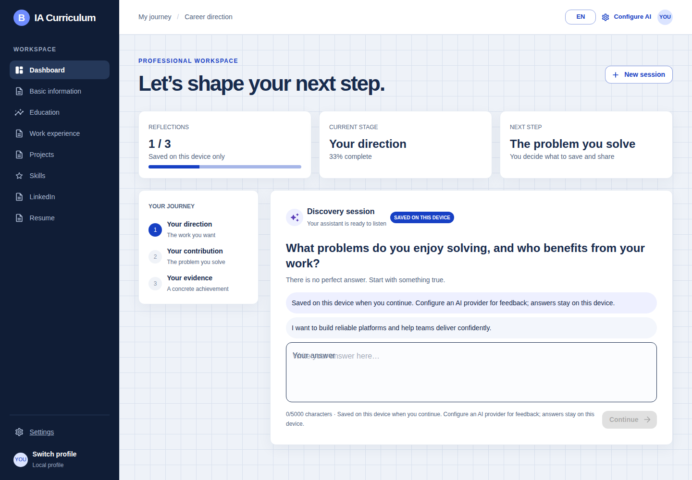](screenshots/reflection-progress.png)

Completion invites the user to review basic information. Reflection answers do not automatically become verified career records.

[](screenshots/reflection-complete.png)

## 4. Add evidence to the shared career source

Edit basic information for this CV, then record experience, education, projects, and skills. Those four sections are shared across all CVs. Review assistant proposals before saving them.

[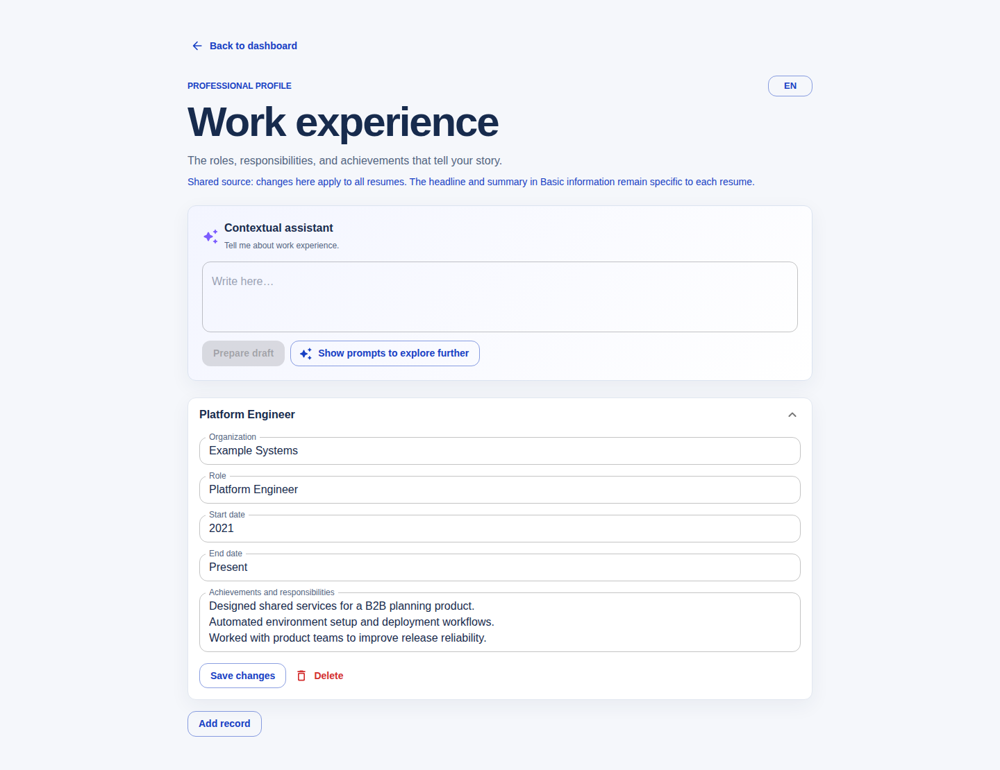](screenshots/experience.png)

## 5. Review the output and appearance

Review the saved headline, summary, and supporting records. In Resume, select a layout, adjust colors, and optionally enable section icons. The Sidebar example shows vertical skills and a contrasting panel.

[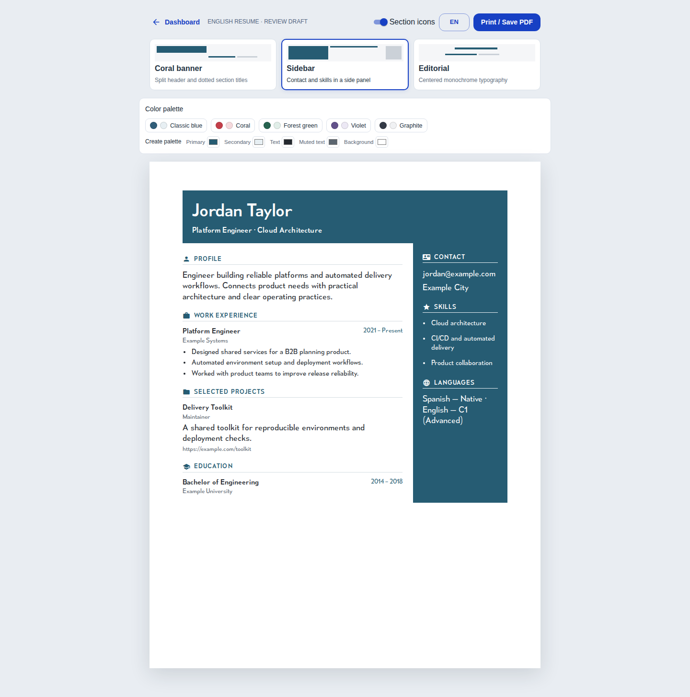](screenshots/cv-custom-palette.png)

Use **Print / Save PDF**, inspect the browser print preview, and review pagination before sharing. This print-media capture demonstrates styling, not every browser or paper size.

[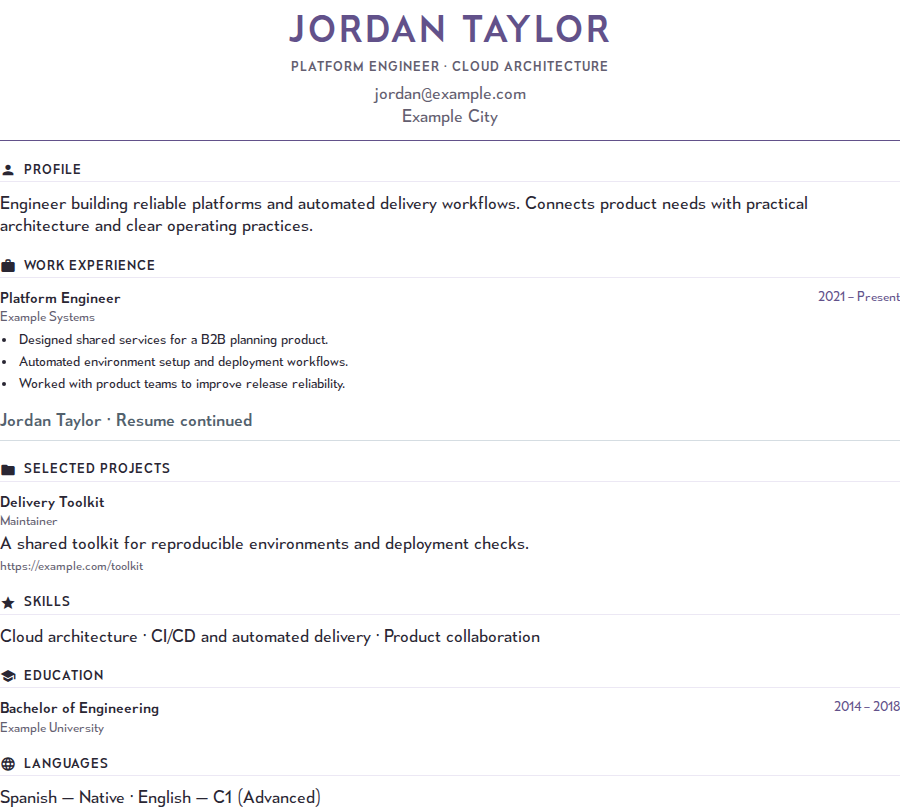](screenshots/cv-print.png)

## 6. Export a backup or configure optional AI

Settings provides JSON export, CV deletion, and optional provider configuration. JSON export includes the CV and shared career source; it excludes provider credentials. Deleting a CV preserves shared records. AI requests require the user's own provider configuration and send data directly to that provider.

[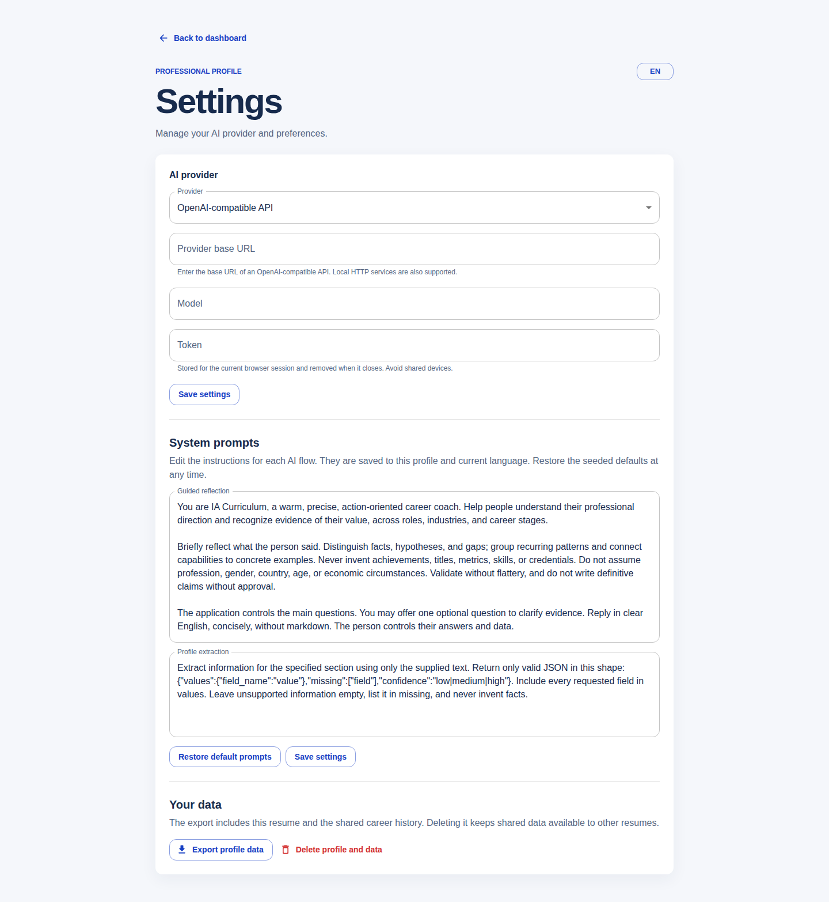](screenshots/settings.png)

## 7. Return for another goal

Create another CV when targeting a different role. Shared career records remain available; the focus, headline, and summary can differ.

[](screenshots/profiles.png)

## Additional views

<details>
<summary>Record editing, LinkedIn preview, and template controls</summary>

[](screenshots/basic-information.png)
[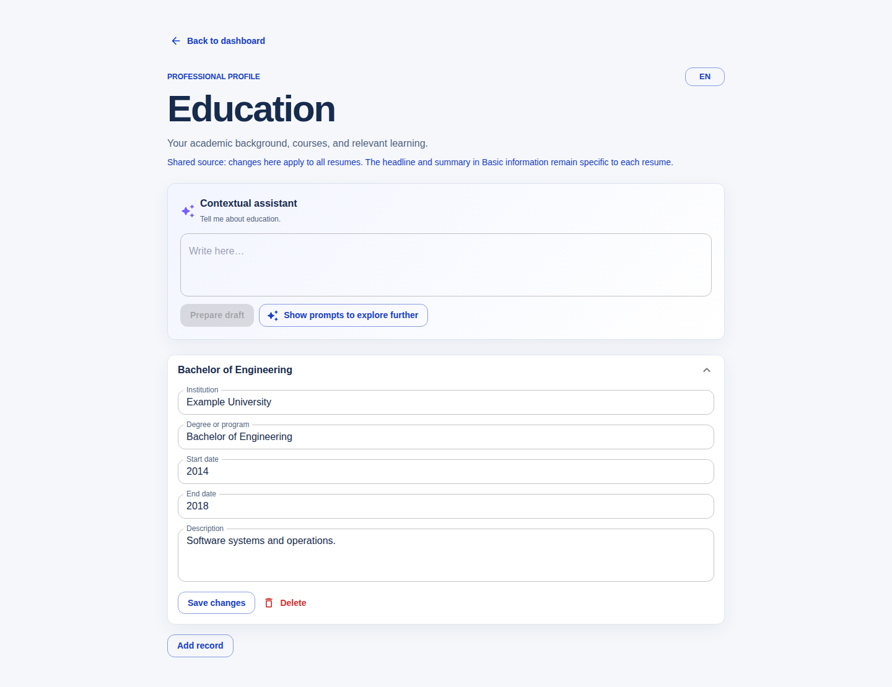](screenshots/education.png)
[](screenshots/projects.png)
[](screenshots/skills.png)
[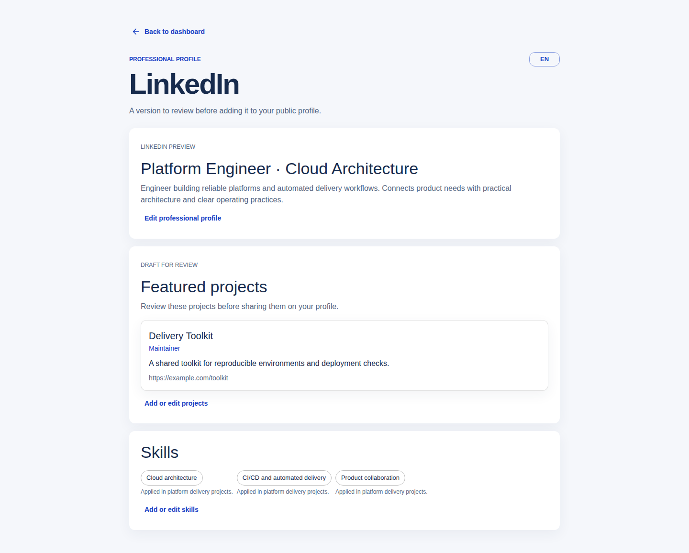](screenshots/linkedin-draft.png)
[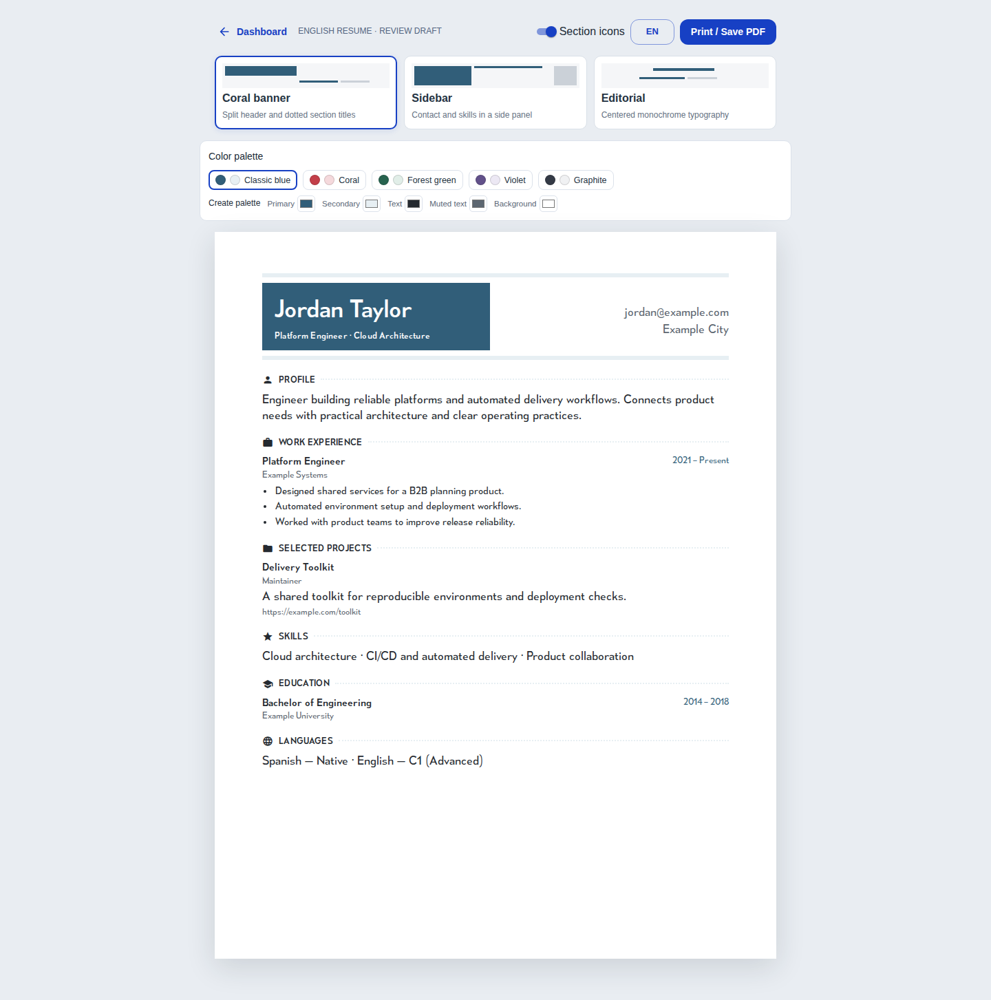](screenshots/cv-template-palette-picker.png)
[](screenshots/cv-editorial-palette.png)

</details>

## Mobile navigation

The mobile menu provides the same destinations and closes after selection.

[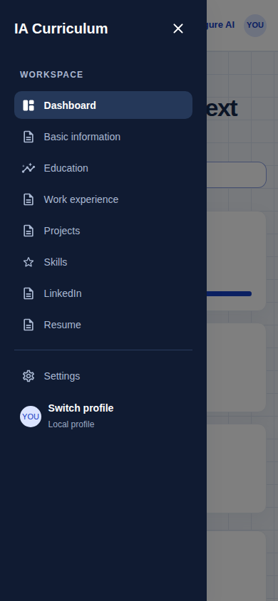](screenshots/mobile-navigation.png)

## Reproduce the captures

```bash
npm run build
npm run start -- -p 3012
# In another terminal:
node scripts/capture-showcase.mjs
```

Set `SHOWCASE_URL` for another local server. The script uses a fresh isolated browser, creates the first CV through the interface, then seeds fictional records for the later editing and output examples. It never reads an existing browser profile. The gallery is a staged walkthrough, not evidence that reflection automatically populates records or that AI generated the examples. Review images before committing them.
