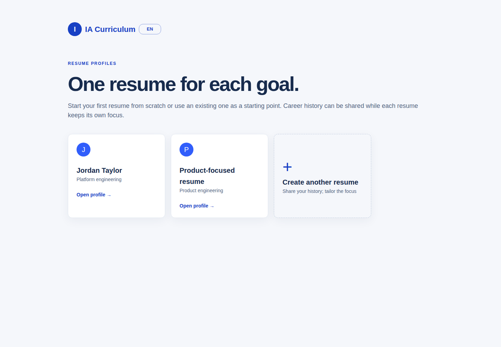
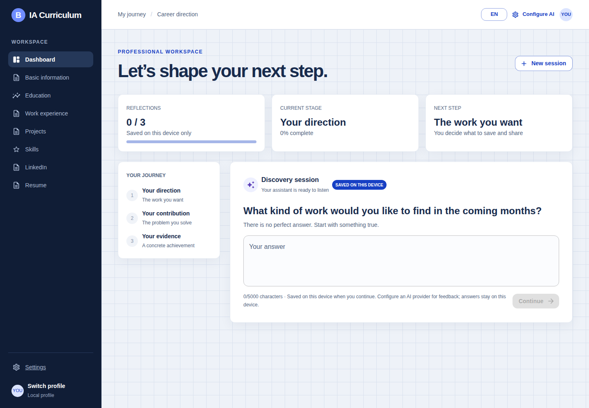
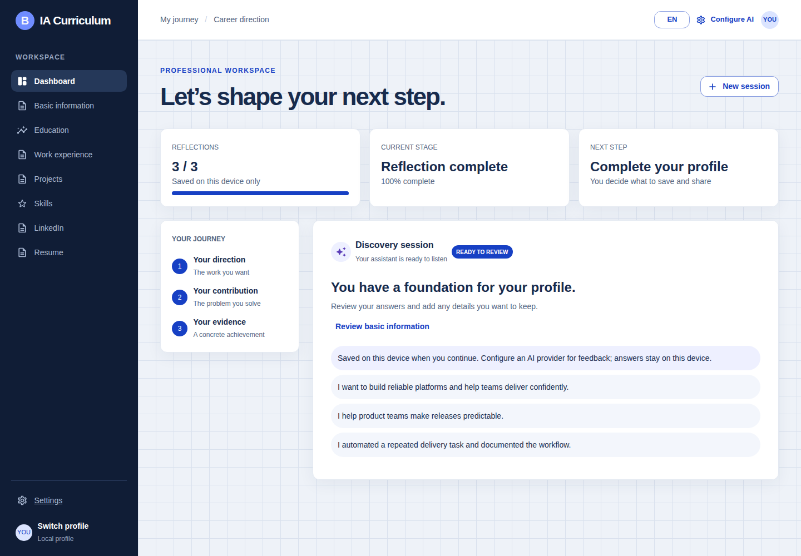
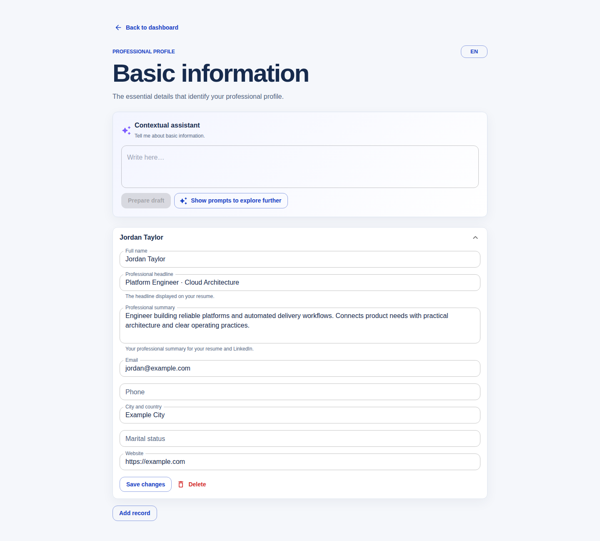
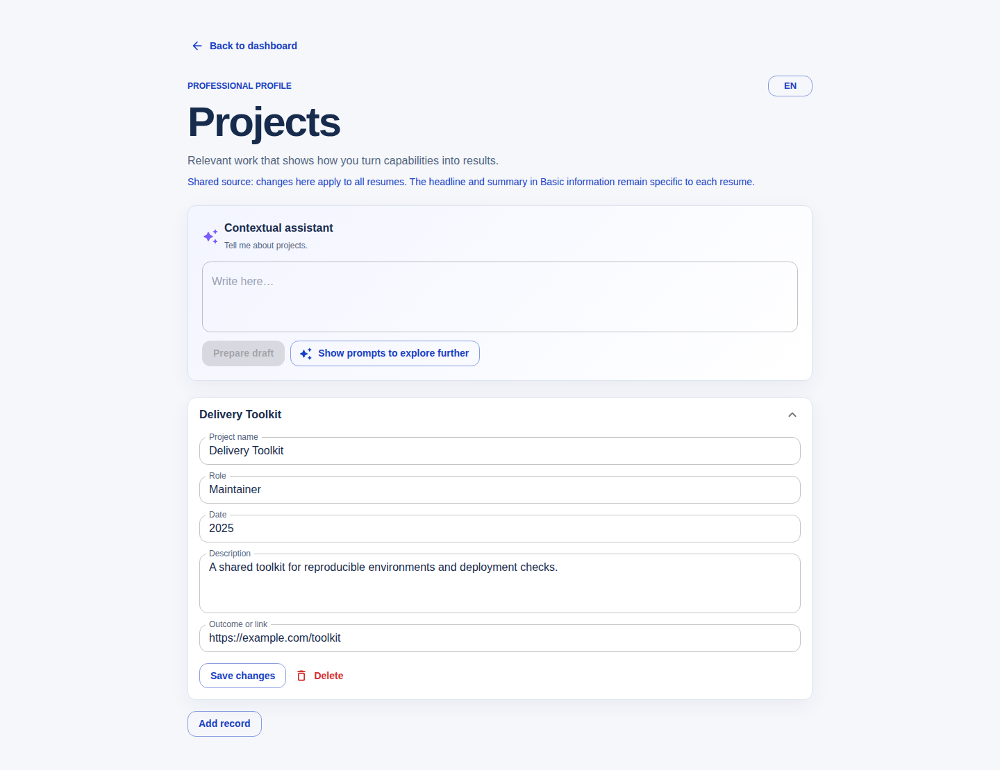
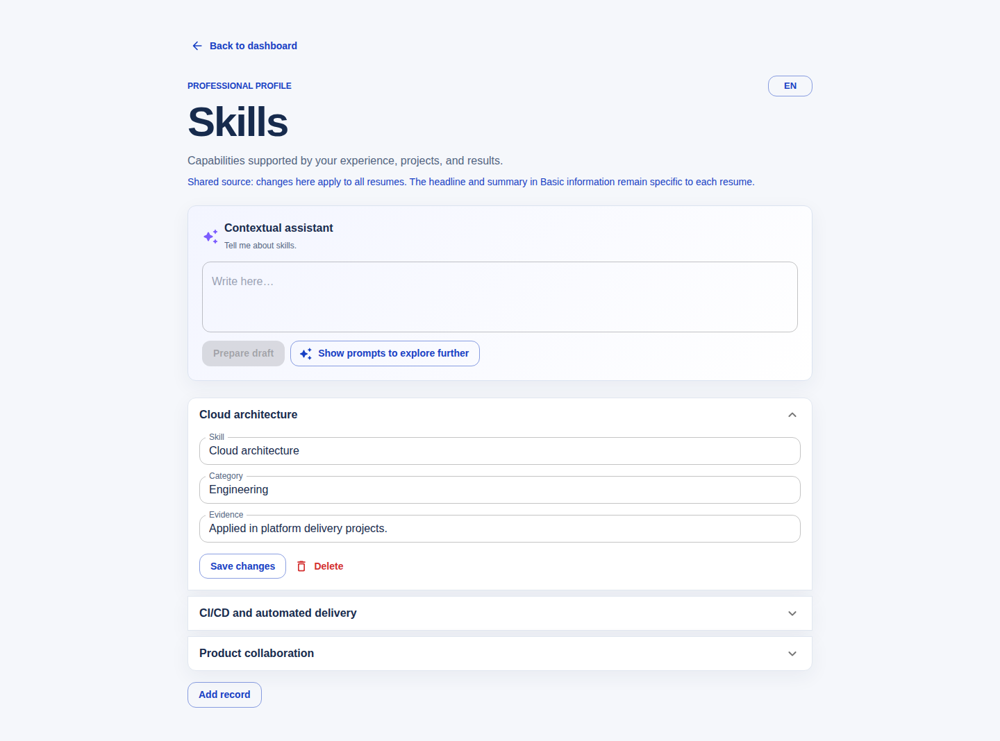
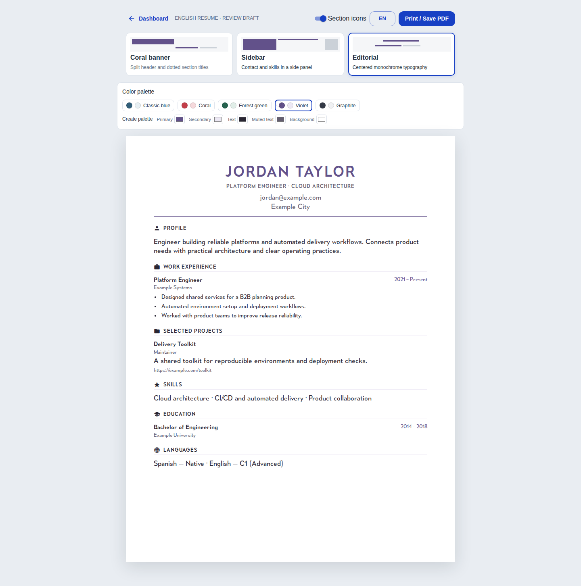

# Screenshot gallery

These screens use fictional sample data generated in a temporary browser session. They do not contain real profile information or provider credentials. All images were refreshed against the MUI 9 application on November 19, 2026.

All screenshots show the English interface for a consistent walkthrough.

## Choose a profile



Each CV can target a different opportunity. The career source (education, experience, projects, and skills) is shared, while each CV keeps its own headline and summary.

## Guided reflection

Start with the first prompt:



After one answer, progress and next step update together:


Review the saved answers when all three prompts are complete:



## Build a professional profile

Basic information:



Experience, including multiline achievements:


Education:


Projects:



Skills:



## Review and export

LinkedIn-oriented profile preview:


Optional provider and local-data settings:


Printable English CV:


The current CV preview offers Coral banner, Sidebar, and Editorial layouts, five preset palettes, and five editable custom colors. Layout and palette are saved per CV. The selector and applied examples below use fictional content.

Template and palette selectors:


Custom palette applied to Sidebar:


Violet palette applied to Editorial:



Definitions are in `lib/profiles/cv-templates.json` and `lib/profiles/cv-palettes.json`.

Mobile navigation:


## Print styling

This capture uses Chromium print media for the Editorial layout. It checks the visible print styles, not pagination across every paper size or browser.


## Refreshing screenshots

Build and start the application, then run the isolated synthetic-data capture script:

```bash
npm run build
npm run start -- -p 3012
# In another terminal:
node scripts/capture-showcase.mjs
```

Set `SHOWCASE_URL` to use another local server. The script creates a fresh browser context, seeds fictional records, walks through reflection and section views, and captures all gallery images in English. It does not read an existing browser profile or use provider credentials. Review the generated images before committing them.
